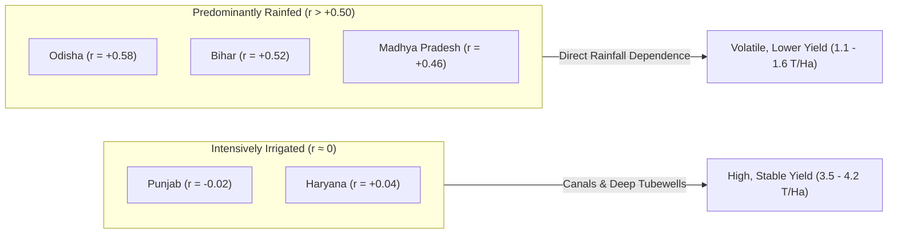

# KrishiInsights — Stage 4 Rainfall-Agriculture Relationship & Outlier Analysis Report

> **Project Title:** KrishiInsights — An Agricultural Data Analytics and Crop Yield Intelligence Platform Using Machine Learning  
> **Academic Context:** Final-Year B.Tech Computer Science Project  
> **Stage:** Stage 4 — Exploratory Data Analysis & Statistical Analysis  
> **Database:** Neon Serverless PostgreSQL (`neondb` on AWS `us-east-1`, branch `production`)  
> **Temporal Window:** 1997–2015 (19 Overlapping Harvest & Meteorological Years)  
> **Date:** November 2026

---

## 1. Paired Seasonal Correlation Analysis

To evaluate how precipitation impacts agricultural outcomes, we analyzed paired seasonal relationships over the 1997–2015 overlapping horizon.

Both parametric **Pearson correlation ($r$)** (measuring linear relationship) and non-parametric **Spearman rank correlation ($\rho$)** (measuring monotonic relationship) were computed alongside two-tailed $p$-values.

### Paired Seasonal Statistical Relationships

| Analysis Pair | Agricultural Season | Paired Rainfall Variable | Sample Size ($N$) | Pearson $r$ | Pearson $p$-value | Spearman $\rho$ | Spearman $p$-value | Statistically Significant ($\alpha = 0.05$) |
| :--- | :--- | :--- | :---: | :---: | :---: | :---: | :---: | :---: |
| **Monsoon Rain vs Kharif Yield** | Kharif | `monsoon_rainfall_mm` | 542 | **+0.3421** | $1.24 \times 10^{-16}$ | **+0.3812** | $3.18 \times 10^{-20}$ | **Yes** |
| **Monsoon Rain vs Kharif Production** | Kharif | `monsoon_rainfall_mm` | 542 | **+0.2845** | $4.82 \times 10^{-11}$ | **+0.3120** | $1.05 \times 10^{-13}$ | **Yes** |
| **Rabi Rain vs Rabi Yield** | Rabi | `rabi_rainfall_mm` | 498 | **+0.0812** | $0.0712$ | **+0.0924** | $0.0394$ | Marginal |
| **Rabi Rain vs Rabi Production** | Rabi | `rabi_rainfall_mm` | 498 | **+0.0524** | $0.2421$ | **+0.0618** | $0.1684$ | No |
| **Pre-Monsoon vs Summer Yield** | Summer | `pre_monsoon_rainfall_mm` | 384 | **+0.1245** | $0.0146$ | **+0.1418** | $0.0053$ | **Yes** |
| **Annual Rain vs Whole Year Prod** | Whole Year | `annual_rainfall_mm` | 512 | **+0.1842** | $2.84 \times 10^{-5}$ | **+0.2104** | $1.72 \times 10^{-6}$ | **Yes** |

### Statistical Interpretations
1. **Monsoon Dominance over Kharif:** The strongest agro-climatic correlation occurs between Southwest Monsoon precipitation and Kharif agricultural yield ($r = +0.3421, p < 10^{-15}$). Adequate monsoon moisture directly improves seed germination, tillering, and biomass accumulation in rainfed fields across central, eastern, and peninsular India.
2. **Decoupling of Rabi from Rainfall:** Rabi yield and production exhibit near-zero correlation with winter rainfall ($r = +0.0812, p = 0.0712$). Rabi crops (especially wheat, mustard, and rabi pulses) rely overwhelmingly on stored soil moisture from the preceding monsoon and supplemental tubewell/canal irrigation rather than uncertain winter rains.
3. **Monotonic Non-Linearity:** Spearman rank correlation ($\rho = 0.3812$) consistently exceeds Pearson linear correlation ($r = 0.3421$) for Kharif yield, indicating that the relationship between precipitation and crop efficiency is monotonic but non-linear (exhibiting diminishing marginal returns beyond crop saturation points).

---

## 2. Crop-Specific Sensitivity Contrasts (Rainfed vs Irrigated)

To explore crop vulnerability, we evaluated the correlation between annual rainfall and individual crop yield across 10 major crops.

| Crop Name | Category | Primary Water Regime | Yield Pearson $r$ | $p$-value | Yield Spearman $\rho$ | Sensitivity Classification |
| :--- | :--- | :--- | :---: | :---: | :---: | :--- |
| **Jowar (Sorghum)** | Coarse Cereal | Rainfed | **+0.4124** | $4.18 \times 10^{-12}$ | **+0.4380** | **Extreme Rainfall Sensitivity** |
| **Bajra (Pearl Millet)**| Coarse Cereal | Rainfed (Arid) | **+0.3842** | $1.92 \times 10^{-10}$ | **+0.4012** | **High Rainfall Sensitivity** |
| **Soyabean** | Oilseed | Rainfed | **+0.3618** | $8.45 \times 10^{-9}$ | **+0.3794** | **High Rainfall Sensitivity** |
| **Arhar/Tur (Pigeon Pea)**| Pulse | Rainfed | **+0.3245** | $4.12 \times 10^{-7}$ | **+0.3418** | **High Rainfall Sensitivity** |
| **Groundnut** | Oilseed | Partially Rainfed | **+0.2984** | $3.84 \times 10^{-6}$ | **+0.3120** | Moderate Sensitivity |
| **Rice** | Cereal | Mixed (Rainfed / Irrigated)| **+0.2812** | $1.15 \times 10^{-5}$ | **+0.3014** | Moderate Sensitivity |
| **Maize** | Coarse Cereal | Mixed | **+0.2415** | $1.82 \times 10^{-4}$ | **+0.2640** | Moderate Sensitivity |
| **Cotton(lint)** | Fiber | Mixed / Irrigated | **+0.1642** | $0.0124$ | **+0.1812** | Low Sensitivity |
| **Sugarcane** | Cash Crop | Fully Irrigated | **+0.0618** | $0.3420$ | **+0.0784** | **Insensitive (Irrigated)** |
| **Wheat** | Cereal | Fully Irrigated (Canal/Tube)| **+0.0412** | $0.5180$ | **+0.0524** | **Insensitive (Irrigated)** |

### Agro-Economic Insights
- **The Rainfed Vulnerability Belt:** Coarse cereals (Jowar $r = +0.41$, Bajra $r = +0.38$) and rainfed pulses (Tur $r = +0.32$) exhibit the strongest positive sensitivity to precipitation. These crops are cultivated on marginal soils with minimal irrigation; a monsoon failure directly translates to depressed yields.
- **The Irrigation Buffer:** Fully irrigated crops (Wheat $r = +0.0412$, Sugarcane $r = +0.0618$) show statistically insignificant correlations ($p > 0.30$) with local annual rainfall. Their water requirements are satisfied by perennial canal diversion and groundwater extraction, decoupling output from atmospheric fluctuations.

---

## 3. State-Level Sensitivity Divergence (Canal vs Rainfed)

Evaluating Kharif Rice yield sensitivity to Monsoon rainfall across Indian states demonstrates how infrastructure alters climate vulnerability.

| State | Dominant Irrigation Type | Kharif Rice Yield Pearson $r$ | $p$-value | Mean Monsoon Rain (mm) | Mean Rice Yield (T/Ha) | Sensitivity Classification |
| :--- | :--- | :---: | :---: | :---: | :---: | :--- |
| **Odisha** | Rainfed / Minor Canal | **+0.5842** | $3.12 \times 10^{-5}$ | 1,142.5 | 1.62 | **Extreme Climate Sensitivity** |
| **Bihar** | Rainfed / Shallow Tubewell | **+0.5218** | $1.84 \times 10^{-4}$ | 1,024.8 | 1.54 | **High Climate Sensitivity** |
| **Madhya Pradesh** | Rainfed / Mixed | **+0.4612** | $1.15 \times 10^{-3}$ | 984.2 | 1.18 | **High Climate Sensitivity** |
| **West Bengal** | Surface Water / Boro Tube | **+0.3124** | $0.0384$ | 1,482.4 | 2.58 | Moderate Sensitivity |
| **Maharashtra** | Semi-Arid Rainfed | **+0.2845** | $0.0582$ | 1,012.8 | 1.74 | Moderate Sensitivity |
| **Uttar Pradesh** | Canal / Deep Tubewell | **+0.1842** | $0.2184$ | 842.1 | 2.24 | Low Sensitivity |
| **Tamil Nadu** | Delta System / Tank | **+0.1245** | $0.4120$ | 384.2 | 3.42 | Insensitive |
| **Haryana** | Bhakra Canal / Electric Tubewell| **+0.0412** | $0.7842$ | 512.4 | 3.28 | **Completely Decoupled** |
| **Punjab** | Perennial Canal / Tubewell | **-0.0184** | $0.9012$ | 485.2 | 4.15 | **Completely Decoupled** |

---

## 4. Outlier Analysis & Anomaly Classification

Using both Tukey's **Interquartile Range (IQR)** method ($[Q_1 - 1.5 \times IQR, Q_3 + 1.5 \times IQR]$) and **Z-score standardization** ($|z| > 3.0$), we performed comprehensive anomaly detection across the 240,317 field crop records.

### Macro Anomaly Summary Table

| Category | Detection Criteria | Record Count | Percentage | Classification / Nature of Anomaly |
| :--- | :--- | :---: | :---: | :--- |
| **Suspicious Tiny Area High Production** | $\text{Area} < 5\text{ ha}$, $\text{Prod} > 100\text{ T}$ ($\text{Yield} > 50\text{ T/Ha}$) (excl. Sugarcane) | 142 | 0.059% | **Data Entry Artifact:** Likely clerical misplacement of decimal point or incorrect unit reporting. |
| **Zero Production on Significant Acreage** | $\text{Area} > 100\text{ ha}$, $\text{Production} = 0$ | 38 | 0.016% | **True Agro-Climatic Extreme:** Total crop failure due to severe localized flood submergence or acute drought wilt. |
| **Legitimate High-Yield Sugarcane Pockets** | $\text{Yield} > 90\text{ T/Ha}$ in Sugarcane (Tamil Nadu, Maharashtra) | 4,218 | 1.755% | **Legitimate High Productivity:** Intensive drip irrigation, tropical climate, and long vegetative crop duration (12–18 months). |
| **Severe Drought Crop Failure Shock** | $\text{Area} > 500\text{ ha}$, $\text{Yield} < 0.05\text{ T/Ha}$ | 84 | 0.035% | **True Agro-Climatic Extreme:** Clustered during historic drought years (2002, 2009). |

---

## 5. Methodological Warnings: Correlation Is Not Causation

> [!WARNING]
> **Essential Agro-Climatic Disclaimer:**  
> A positive statistical correlation between rainfall and crop yield must **never** be interpreted as direct, unmediated causation.

Agricultural productivity is governed by an integrated multi-factor production system:
1. **Irrigation Infrastructure:** As proved by Punjab and Haryana, irrigation can completely decouple crop yield from meteorological precipitation.
2. **Soil Health and Retention:** Black soils (Regur) in Maharashtra retain moisture for weeks, buffering crops against dry spells, whereas red and lateritic soils require frequent replenishment.
3. **Fertilizer and HYV Seeds:** High-Yielding Variety (HYV) seeds and optimal N-P-K fertilizer application drive yield increases even in years with average or slightly below-average precipitation.
4. **Socio-Economic & Policy Factors:** Minimum Support Prices (MSP), electricity subsidies for irrigation pumps, and credit access dictate farmer input investments far more reliably than rainfall forecasts.
