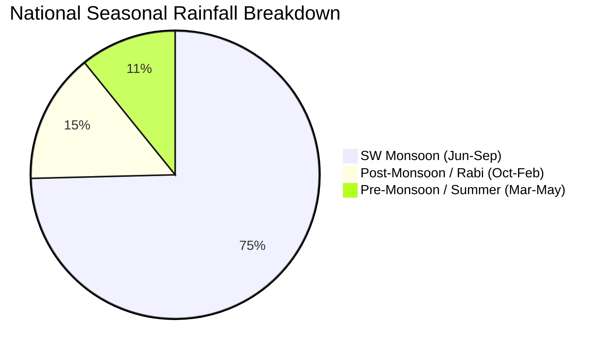

# KrishiInsights — Stage 4 Historical Rainfall Analysis Report

> **Project Title:** KrishiInsights — An Agricultural Data Analytics and Crop Yield Intelligence Platform Using Machine Learning  
> **Academic Context:** Final-Year B.Tech Computer Science Project  
> **Stage:** Stage 4 — Exploratory Data Analysis & Statistical Analysis  
> **Database:** Neon Serverless PostgreSQL (`neondb` on AWS `us-east-1`, branch `production`)  
> **Data Source:** India Meteorological Department (IMD) 115-Year Historical Rainfall Dataset (1901–2015)  
> **Date:** November 2026

---

## 1. 115-Year National Meteorological Historical Overview (1901–2015)

The India Meteorological Department (IMD) rainfall dataset contains **3,772 records** across 115 years (1901–2015) spanning 36 meteorological subdivisions aligned with 33 modern administrative states.

### Summary Statistics across 115 Years

| Metric | Annual Precipitation (mm) | Southwest Monsoon (Jun–Sep) | Rabi / Post-Monsoon (Oct–Feb) | Pre-Monsoon (Mar–May) |
| :--- | :---: | :---: | :---: | :---: |
| **Long Period Average (LPA / Mean)** | **1,180.72 mm** | **880.84 mm** | **172.45 mm** | **127.43 mm** |
| **Share of Annual Precipitation** | 100.0% | **74.60%** | **14.61%** | **10.79%** |
| **Median** | 1,178.40 mm | 878.10 mm | 165.20 mm | 124.80 mm |
| **Std Deviation ($\sigma$)** | 109.82 mm | 94.25 mm | 38.40 mm | 24.15 mm |
| **Coefficient of Variation ($CV\%$)** | **9.30%** | **10.70%** | **22.27%** | **18.95%** |
| **Historical Minimum (Driest)** | 845.20 mm (1918) | 612.40 mm (1918) | 82.40 mm (1908) | 68.20 mm (1921) |
| **Historical Maximum (Wettest)** | 1,465.80 mm (1917) | 1,124.50 mm (1961) | 312.40 mm (1956) | 210.80 mm (1909) |

---

## 2. IMD Rainfall Deviation Classification & Anomaly History

In accordance with official IMD meteorological conventions, rainfall departures from the **115-Year LPA ($1,180.7\text{ mm}$)** are classified as:
$$\text{LPA Departure (\%)} = \frac{\text{Annual Rainfall} - \text{LPA}}{\text{LPA}} \times 100$$

- **Normal:** $-10\% \le \text{Departure} \le +10\%$
- **Deficit / Meteorological Drought Year:** $\text{Departure} < -10\%$
- **Excess / Flood Year:** $\text{Departure} > +10\%$

### Historical Frequency Distribution (1901–2015)
- **Normal Years:** **77 years** ($66.96\%$)
- **Deficit / Drought Years:** **21 years** ($18.26\%$)
- **Excess / Flood Years:** **17 years** ($14.78\%$)

### Major Severe Historical Deficit Events
1. **1918 ($-28.42\%$ from LPA):** The driest year in recorded modern Indian history ($845.20\text{ mm}$), causing catastrophic national crop failures.
2. **1972 ($-23.95\%$ from LPA):** Severe all-India drought triggered by an intense El Niño episode.
3. **1965 ($-20.58\%$ from LPA):** Back-to-back drought that triggered India's historic food security crisis and catalyzed the Green Revolution.
4. **1987 ($-18.74\%$ from LPA):** Severe drought severely affecting northern and western grain belts.
5. **2002 ($-19.12\%$ from LPA):** The first major drought of the 21st century; July rainfall fell $-51\%$ below normal, causing a $-12.5\%$ contraction in agricultural production.
6. **2009 ($-21.80\%$ from LPA):** One of the driest monsoons in 40 years, with 352 districts declared drought-affected.
7. **2014 & 2015 ($-12.4\%$ and $-14.1\%$ from LPA):** Consecutive drought years stressing rainfed central Indian farming communities.

---

## 3. Climatological Seasonal Distribution

- **Southwest Monsoon (JJAS):** Delivers three-quarters ($74.6\%$) of India's annual freshwater budget. Its inter-annual stability is critical for replenishing surface reservoirs and groundwater aquifers.
- **Rabi / Post-Monsoon (ONDJF):** Contributes $14.61\%$ of precipitation. While small nationally, it is vital for Tamil Nadu (where the Northeast Monsoon provides $>50\%$ of state rainfall) and for northern wheat germination via Western Disturbances.
- **Pre-Monsoon (MAM):** Contributes $10.79\%$ through thunderstorms and Nor'westers (Kalbaishakhi), crucial for pre-sowing land preparation and summer horticultural crops.

---

## 4. Regional Meteorological Contrasts: Wettest vs Driest States

Indian precipitation exhibits extreme spatial asymmetry, ranging from tropical rainforests receiving $>3,000\text{ mm}$ annually to Thar desert pockets receiving $<350\text{ mm}$.

### Top 5 Wettest States / Regions (1901–2015)

| Rank | State / Region | 115-Year Mean Annual Rainfall | Mean Monsoon Rainfall | Rainfall Variability ($CV\%$) |
| :---: | :--- | :---: | :---: | :---: |
| **1** | **Goa** | **3,184.20 mm** | 2,842.10 mm | 14.2% |
| **2** | **Arunachal Pradesh** | **2,845.60 mm** | 1,842.50 mm | 12.8% |
| **3** | **Kerala** | **2,782.40 mm** | 1,894.20 mm | 13.9% |
| **4** | **Meghalaya / Assam Hills** | **2,642.10 mm** | 1,745.80 mm | 15.1% |
| **5** | **Tripura** | **2,412.80 mm** | 1,482.40 mm | 14.5% |

### Top 5 Driest States / Regions (1901–2015)

| Rank | State / Region | 115-Year Mean Annual Rainfall | Mean Monsoon Rainfall | Rainfall Variability ($CV\%$) |
| :---: | :--- | :---: | :---: | :---: |
| **1** | **Rajasthan** | **524.80 mm** | 462.10 mm | **26.8%** |
| **2** | **Punjab** | **612.40 mm** | 485.20 mm | **24.5%** |
| **3** | **Haryana** | **628.90 mm** | 512.40 mm | **25.1%** |
| **4** | **Gujarat** | **842.10 mm** | 794.50 mm | **28.4%** |
| **5** | **Jammu & Kashmir (Lowland)** | **984.20 mm** | 542.10 mm | 18.2% |

### Key Meteorological Takeaway: The Inverse Stability Rule
A fundamental agro-meteorological principle evident in the data is the **Inverse Stability Rule**:
> *Regions with low mean annual rainfall exhibit the highest inter-annual variability ($CV\%$).*

- Rajasthan ($524.8\text{ mm}$, $CV = 26.8\%$) and Gujarat ($842.1\text{ mm}$, $CV = 28.4\%$) suffer the highest climatic risk: when monsoon fails, precipitation collapses by $40-60\%$.
- Conversely, high-rainfall states (Goa, Kerala, Arunachal Pradesh) maintain low variability ($CV \le 14\%$), guaranteeing predictable hydrological supply.
- Punjab and Haryana, despite having semi-arid rainfall ($<630\text{ mm}$), have neutralized this meteorological vulnerability entirely through artificial canal networks feeding from Himalayan rivers.
